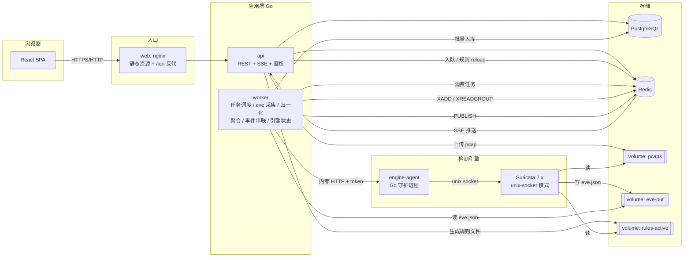
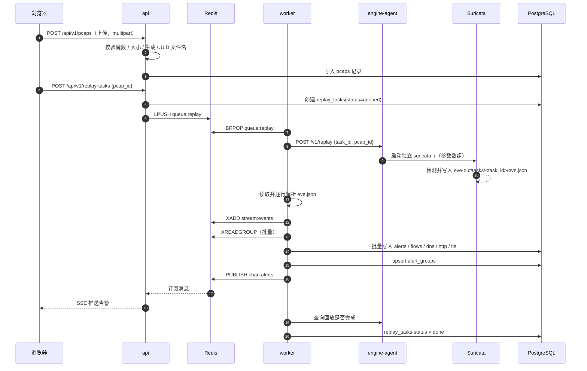

# 流量威胁检测系统：架构设计

> 依据 [需求梳理.md](需求梳理.md) 编写。技术栈：后端 **Go**、前端 **React**、数据库 **PostgreSQL + Redis**、检测引擎 **Suricata 7.x**，全部通过 Docker Compose 部署。
> 标注“待验证”的条目依赖 Suricata 实际行为，需要在 T+0–4h 的最小闭环中用真实环境确认。

## 1. 设计目标与取舍

| 目标 | 设计策略 |
|---|---|
| 48 小时内跑通完整闭环 | 单仓库、单 Go module、少量服务；先打通 pcap → 页面，再逐项补充 |
| 数据可自验 | 评测程序作为黑盒，仅通过公开 API 取告警，不直接读 Suricata 输出或数据库 |
| 干净环境一键启动 | 所有组件容器化，迁移与种子数据在启动时自动执行，无需手工配置 |
| 系统自身安全 | 不挂载 `docker.sock`，不拼接 shell 命令，所有外部输入走白名单校验与参数化 |
| 不重复造重型组件 | 不做集群、全流量存储；用 PostgreSQL 承载持久数据，Redis 承载队列、缓存、推送 |

> ⚠️ 当前机器 Docker Desktop 守护进程未运行（Compose v5.3.1 已安装）。实施前需先启动 Docker Desktop，否则无法验证任何容器化步骤。

## 2. 总体架构



### 服务清单

| 服务 | 技术 | 职责 | 对外暴露 |
|---|---|---|---|
| `web` | nginx + React 构建产物 | 静态资源、反向代理 `/api`、安全响应头（CSP 等） | 仅此服务发布端口，绑定 `127.0.0.1:8080` |
| `api` | Go | REST API、登录与权限、上传校验、规则管理、SSE、取证导出 | 仅内部网络 |
| `worker` | Go | 回放任务调度、eve.json 采集、归一化、聚合、攻击事件串联、引擎指标 | 无 |
| `suricata` | 自定义镜像：Suricata 7.x + `engine-agent` | 常驻 unix-socket 实例负责规则校验/热重载与状态；回放由 agent 为每个任务起独立 `suricata -r` 进程（见 §3.1 修订） | 仅内部网络 |
| `postgres` | PostgreSQL 16 | 持久化数据 | 仅内部网络（调试时可通过 profile 开放） |
| `redis` | Redis 7 | 事件流、任务队列、聚合窗口、会话、缓存、Pub/Sub | 仅内部网络 |
| `validator` | Python + Scapy（`tools` profile） | 生成 pcap、回放、对照 ground truth、输出报告 | 一次性运行 |

> 镜像实施时必须锁定到具体 tag 并记录 digest（Suricata、Postgres、Redis、Node、Go、nginx 均如此），以满足 M6。

## 3. 关键设计决策

### 3.1 回放任务状态隔离

- engine-agent 为每个回放任务串行启动独立的 `suricata -r` 进程，输出到 `eve-out/tasks/<task_id>/`。每次回放重新初始化 Suricata 的 host 与阈值状态，避免任务之间互相污染。
- 参数由 agent 固定并以参数数组传入；回放显式关闭 unix-command，不使用 shell。单任务超时为 5 分钟，执行失败时通过状态接口的 `errors[task_id]` 返回原因。
- 常驻 Suricata 进程仍以 unix-socket 模式运行，负责状态查询及规则热重载；候选规则先通过 `suricata -T` 校验。规则文件取自 `rules-active`，因此每个独立回放进程也会使用当前已启用规则。
- 实测常驻实例通过 `pcap-file` 连续处理任务时会保留 host/`detection_filter` 阈值状态；同一慢扫 pcap 的命中数曾随前序任务变化。详见 agent-log Bug-26、D-12。
- 不挂载 `docker.sock`：api 与 worker 无权控制宿主 Docker，攻击面更小。C5 并发回放仍未实现，任务由 agent 串行执行。

### 3.2 `engine-agent`：把对引擎的所有操作收敛到一个窄接口

`engine-agent` 与 Suricata 同容器，由其监督 Suricata 进程，仅在内部网络监听，所有请求需携带共享令牌。

| 接口 | 作用 | 安全约束 |
|---|---|---|
| `POST /v1/replay` | 提交回放：参数仅 `pcap_id`、`task_id`（UUID） | 路径由 agent 自行拼接，不接受调用方传入路径 |
| `POST /v1/validate-rules` | 对候选规则执行 `suricata -T` | 固定参数列表，候选文件名由 agent 生成 |
| `POST /v1/reload` | 触发规则重载并返回耗时与结果 | 无自由参数 |
| `GET /v1/status` | 运行状态、规则加载耗时、计数器 | 只读 |

> 使用 `exec.Command` 并以参数数组传递，绝不使用 `sh -c`；这是 M7 命令注入防护的核心。

### 3.3 数据库分工：PostgreSQL 是唯一事实来源，Redis 只放可重建或短期数据

| Redis 用途 | 数据结构 | 说明 |
|---|---|---|
| 归一化事件缓冲 | Stream `stream:events` + Consumer Group | worker 解析 eve 行后 `XADD`；写入协程 `XREADGROUP` 批量落库；至少一次投递，靠 PG 唯一键去重 |
| 回放任务队列 | List `queue:replay` | PG `replay_tasks` 为真相，Redis 仅用于唤醒；worker 重启后可从 PG 恢复 `queued` 任务 |
| 聚合窗口 | `SET agg:<group_hash> <group_id> EX N` | 同签名 + 同五元组在 N 秒内命中同一组；窗口 N 可配置 |
| 会话与限流 | String + TTL | 登录会话、登录失败计数、API 限流 |
| 实时推送 | Pub/Sub `chan:alerts` | worker 发布，api 订阅并通过 SSE 推给浏览器 |
| 看板缓存 | String（JSON）+ 短 TTL | Top N、趋势等聚合查询缓存，写入时失效或 TTL 过期 |

> Redis 丢数据只会影响实时性与缓存，不会丢失已确认入库的告警。需要持久化时开启 AOF；本题以演示为主，可使用默认 RDB。

### 3.4 聚合不丢原始事件

- 原始告警 **全部保留** 在 `alerts`，聚合只产生 `alert_groups` 作为 UI 视图与处置单元。
- 分组键包含 `sid + 五元组`。端口扫描会因目的端口不同而自然分开；不同 sid 属于不同阶段，也不会被合并。
- 组内记录 `first_seen`、`last_seen`、`hit_count`；设置最大组跨度，避免长期持续攻击被永久合并成一条。
- 评测程序使用原始告警视图（`view=raw`），因此聚合策略不会影响 TP/FP/FN 的计算。
- 去重率 = 原始告警数 ÷ 聚合后组数。

### 3.5 时间戳与时延口径

- 离线回放时，eve.json 的 `timestamp` 是 pcap 中数据包的时间，不是当前时间。因此 ground truth 的时间窗必须使用 pcap 内的固定时间；生成脚本应使用固定随机种子，确保结果可复现。
- 告警时延不能简单用 `入库时间 − 数据包时间`（相差可能是数天）。建议口径：`入库时间 − 任务开始回放时间`，并在报告中明确声明这是“回放管线时延”。如需更贴近原题面，可额外统计“告警相对首个攻击包的偏移”。

## 4. 数据流

### 4.1 pcap 回放到页面



### 4.2 规则启停

1. 前端调用 `PATCH /api/v1/rules/{sid}`，请求体仅包含 `{enabled: true|false}`。
2. api 在 PG 事务内更新规则，并写入 `rule_revisions` 与 `audit_log`。
3. api 根据当前启用的规则生成完整规则文件，先写临时文件，再原子重命名到 `rules-active`。
4. api 调用 `engine-agent` 的 `validate-rules`；失败则事务回滚并向前端返回具体错误。
5. 校验通过后调用 `reload`，返回重载耗时，界面显示“已生效”及规则版本号。

## 5. 数据模型（PostgreSQL）

### 5.1 核心表

| 表 | 关键字段 | 说明 |
|---|---|---|
| `users` | id, username, password_hash, role, created_at | 密码使用 argon2id；角色：`viewer` / `analyst` / `admin` |
| `pcaps` | id(UUID), original_name, stored_path, size, packet_count, sha256, sample_type, created_at | `original_name` 仅用于展示，不参与路径拼接 |
| `replay_tasks` | id(UUID), pcap_id, status, started_at, finished_at, error, rules_version | 状态：queued / running / ingesting / done / failed |
| `rules` | sid(PK), raw, msg, enabled, classtype, severity, stage, mitre_tactic, mitre_technique, source | `stage` / `mitre_*` 来自规则 `metadata` |
| `rule_revisions` | id, version, snapshot, actor, created_at | 每次规则变更生成新版本，支持审计与回溯 |
| `alerts` | id, task_id, ts, ingested_at, flow_id, community_id, src_ip, src_port, dest_ip, dest_port, proto, app_proto, sid, signature, severity, category, payload_printable, raw JSONB, group_id, dedup_key | 原始告警；`UNIQUE(task_id, dedup_key)` 保证重复消费幂等 |
| `alert_groups` | id, group_hash, sid, 五元组, first_seen, last_seen, hit_count, status, assignee, updated_at | 聚合视图与处置状态载体 |
| `flows` | flow_id, task_id, 五元组, app_proto, pkts/bytes toserver/toclient, start, end, state | 与告警通过 `flow_id + task_id` 关联 |
| `dns_events` / `http_events` / `tls_events` | task_id, flow_id, ts + 协议关键字段 + raw JSONB | 仅提取研判关键字段，原文保存在 `raw` |
| `incidents` | id, src_ip, start, end, stage_summary, severity | 同一源 IP 的攻击事件 |
| `incident_alerts` | incident_id, group_id, stage_order | 事件与告警组的关联 |
| `triage_actions` | id, group_id, from_status, to_status, actor_id, note, created_at | 处置流转审计 |
| `audit_log` | id, actor_id, action, target, detail JSONB, created_at | 登录、规则变更、上传等敏感操作 |
| `engine_stats` | ts, uptime, rules_loaded, rule_load_ms, kernel_drops, alerts_per_min | 引擎可观测数据，来自 eve `stats` 事件 |

### 5.2 索引建议

| 表 | 索引 | 目的 |
|---|---|---|
| `alerts` | `(ts DESC)`、`(src_ip, ts)`、`(sid, ts)`、`(task_id)` | 列表、Top 统计、评测按任务取数 |
| `alert_groups` | `(status, last_seen DESC)`、`(group_hash)` | 状态过滤与聚合更新 |
| `flows` | `(task_id, flow_id)` | 告警详情关联 flow |

> 排序字段与过滤字段必须使用服务端白名单映射，不直接把前端参数拼进 SQL。动态筛选使用查询构造器，值一律绑定参数。

## 6. 后端设计（Go）

### 6.1 技术选型

| 领域 | 选型 | 理由 |
|---|---|---|
| HTTP 路由 | chi | 轻量、中间件清晰 |
| PostgreSQL | pgx + sqlc | 类型安全，查询全部参数化；批量写入可用 `CopyFrom` |
| 迁移 | goose 或 golang-migrate | 启动时自动执行，满足一键启动 |
| Redis | go-redis | 原生支持 Streams、Pub/Sub |
| 日志 | 标准库 `log/slog`（JSON） | 结构化日志，字段包含 task_id / sid 等 |
| 配置 | 环境变量 + `.env` | 密钥不入库、不入 Git |
| pcap 解析（取证） | gopacket/pcapgo | 纯 Go 解析与写出，不调用外部 `tcpdump` |
| 测试 | 标准 `testing` + testcontainers 或 compose 集成测试 | 覆盖归一化、聚合、规则生成等核心逻辑 |

### 6.2 代码结构

```text
backend/
├── cmd/
│   ├── api/                  # HTTP 服务入口
│   ├── worker/               # 调度 / 采集 / 聚合 入口
│   └── engine-agent/         # Suricata 旁路控制进程
├── internal/
│   ├── config/               # 环境变量加载与校验
│   ├── auth/                 # 会话、密码哈希、RBAC 中间件
│   ├── httpapi/              # handler、DTO、校验
│   ├── store/                # sqlc 生成代码与事务封装
│   ├── eve/                  # eve.json 解析与归一化
│   ├── ingest/               # Stream 生产者 / 消费者、批量写入
│   ├── aggregate/            # 告警聚合
│   ├── incident/             # 攻击事件串联
│   ├── rules/                # 规则解析、metadata 提取、文件生成
│   ├── engine/               # engine-agent 客户端与服务端
│   ├── forensics/            # pcap 片段提取
│   ├── realtime/             # Pub/Sub 与 SSE
│   └── observability/        # 健康检查、引擎指标
├── migrations/
├── queries/                  # sqlc 查询
├── Dockerfile.api
├── Dockerfile.worker
└── go.mod
```

### 6.3 REST API（前缀 `/api/v1`）

| 分类 | 接口 | 权限 | 说明 |
|---|---|---|---|
| 认证 | `POST /auth/login`、`POST /auth/logout`、`GET /auth/me` | 公开 / 登录 | 会话存于 Redis，通过 HttpOnly Cookie 传递 |
| 告警 | `GET /alerts` | viewer+ | 过滤、排序、分页；`view=raw|grouped` |
| 告警 | `GET /alerts/{id}` | viewer+ | 详情：签名、规则原文、原始 JSON、关联 flow、payload |
| 告警 | `GET /alert-groups`、`PATCH /alert-groups/{id}/status` | viewer+ / analyst+ | 状态流转，写入审计 |
| 告警 | `GET /alerts/{id}/pcap` | analyst+ | 导出对应时间窗和五元组的 pcap 片段 |
| 总览 | `GET /overview` | viewer+ | 趋势、Top 源 IP / 签名 / 目的端口 |
| 事件 | `GET /incidents`、`GET /incidents/{id}` | viewer+ | 攻击事件与阶段 |
| 规则 | `GET /rules`、`GET /rules/{sid}` | viewer+ | 查看 |
| 规则 | `PATCH /rules/{sid}` | analyst+ | 启停并重载 |
| 数据 | `POST /pcaps`、`GET /pcaps` | analyst+ / viewer+ | 上传与列表 |
| 任务 | `POST /replay-tasks`、`GET /replay-tasks[/{id}]` | analyst+ / viewer+ | 回放任务与状态 |
| 引擎 | `GET /engine/status` | viewer+ | 运行状态、规则加载耗时、丢包、吞吐 |
| 评测 | `GET /validation/latest` | viewer+ | 读取 `report.json` 并展示 |
| 实时 | `GET /stream` | viewer+ | SSE：新告警、任务状态变化 |
| 运维 | `GET /healthz`、`GET /readyz` | 内部 | 存活与就绪探针 |

> 评测专用的“按任务取原始告警”可复用 `GET /alerts?task_id=...&view=raw`，不需要额外接口。

### 6.4 采集与归一化流程

1. worker 监听回放任务对应的 eve 输出目录，逐行读取 JSON；单行解析失败只记录日志并计数，不中断整个任务。
2. 按 `event_type` 分发到 alert / flow / dns / http / tls 映射器，其他类型（如 `stats`）进入各自处理分支。
3. 生成 `dedup_key`（对 `flow_id`、时间戳、事件类型、sid 等稳定字段做哈希），随事件写入 Redis Stream。
4. 消费者批量读取并通过 `CopyFrom` / 批量 upsert 入库，成功后 `XACK`。
5. 对告警执行聚合与事件串联，然后发布实时消息。
6. 任务读到文件末尾且 Suricata 报告回放完成后，才将任务置为 `done`，避免尾部 flow 事件丢失（flow 在 pcap 结束时的刷新行为待验证）。

> Windows Docker Desktop 下对绑定挂载的文件变更通知不可靠。`eve-out` 应使用命名卷，采集采用“轮询读取文件偏移量”，不依赖 inotify。

### 6.5 攻击事件串联

- 规则 `metadata` 中约定 `stage`（如 `recon` / `bruteforce` / `exploit` / `c2` / `exfil`）以及 `mitre_tactic`、`mitre_technique`，导入规则时解析入库。
- 串联策略：同一 `src_ip` 的告警组，若相邻告警时间间隔小于可配置的 gap，则归入同一事件；事件内按阶段顺序及首次出现时间排序，生成“扫描 → 爆破 → 入侵”这样的阶段序列。
- 阶段来自规则元数据，而不是临时猜测，因此 ATT&CK 映射（C3）可复用同一套数据。

### 6.6 鉴权与权限

- 会话 ID 为高熵随机值，服务端存 Redis；Cookie 使用 `HttpOnly`、`SameSite=Strict`，非 GET 请求要求自定义请求头作为 CSRF 防护。
- 角色权限：`viewer` 只读；`analyst` 可处置告警、上传 pcap、回放、启停规则；`admin` 可管理用户（初始账号由环境变量种子化）。
- 登录失败计数写入 Redis，超过阈值短时锁定。

## 7. 前端设计（React）

### 7.1 技术选型

| 领域 | 选型 | 理由 |
|---|---|---|
| 构建 | Vite + TypeScript | 启动快，类型约束 |
| UI 组件 | Ant Design（需在 README 注明来源） | 表格、表单、抽屉等研判界面组件齐全 |
| 数据请求 | TanStack Query | 缓存、分页、失效与重试 |
| 路由 | React Router | 标准方案 |
| 图表 | ECharts | 趋势、Top N、事件时间线 |
| 实时 | 浏览器原生 `EventSource`（SSE） | 单向推送足够，无需 WebSocket |

### 7.2 页面与信息架构

| 页面 | 内容 | 对应需求 |
|---|---|---|
| 登录 | 用户名密码 | S5 |
| 总览 | 时间趋势、Top 源 IP / 签名 / 目的端口、待处置数量 | M4 |
| 告警列表 | 过滤（时间、IP、sid、severity、协议、状态）、排序、分页、聚合/原始切换 | M4、S1 |
| 告警详情 | 签名与规则原文、原始 JSON、关联 flow、payload 摘录、处置操作、取证导出 | M4、S2、S4 |
| 攻击事件 | 按源 IP 的阶段时间线 | S3、C3 |
| 规则管理 | 搜索、查看原文、启停并显示生效状态与版本 | M4 |
| 数据与回放 | 上传 pcap、发起回放、任务进度 | M1 |
| 引擎状态 | 运行状态、规则加载耗时、丢包、吞吐 | S6 |
| 自验报告 | 展示 `report.json`：场景表、TP/FP/FN、误报与变异结果 | D3、D4 |
| 审计日志 | 处置与规则变更记录 | S2 |

### 7.3 前端安全约束

- 所有 payload、域名、URL、User-Agent 等来自流量的字符串，一律作为文本渲染。
- 禁止使用 `dangerouslySetInnerHTML`；可在 ESLint 规则中直接禁止，并在审查清单中复核。
- nginx 设置 CSP：`default-src 'self'`，脚本仅允许同源，并配合 `X-Content-Type-Options`、`X-Frame-Options` 等响应头。
- 原始 JSON 使用代码块文本展示，不做 HTML 高亮注入。

## 8. 数据自验设计

```text
validation/
├── gen/                      # Scapy 场景生成（固定随机种子、固定时间戳）
├── ground_truth/             # 每个 pcap 一份 JSON，先写后测
├── run_validation.py         # 上传 → 回放 → 取原始告警 → 比对
├── report.json
└── report.md
```

- 评测程序通过 `api` 登录并调用公开接口；它不直接读取 Postgres、Redis 或 Suricata 日志，因此验证的是真实产品路径。
- 在 Compose 中以 `validator` 服务（`tools` profile）运行，Makefile 的 `validate` 目标调用 `docker compose --profile tools run --rm validator`，避免宿主机配置 Python/Scapy。
- Windows 可能没有 `make`，因此另提供等价的 PowerShell 脚本包装同一条 compose 命令。
- 变异测试在同一框架内标记 `variant_of`，报告按“基线 / 变种”对比检出率，并附原因分析。
- 误报明细由负样本产生的每条原始告警自动列出，仍需人工补充原因与处理措施。

## 9. 部署与目录

### 9.1 Compose 要点

- 仅 `web` 发布端口，绑定到 `127.0.0.1`；其他服务只加入内部网络。
- 命名卷：`pgdata`、`redisdata`、`pcaps`、`eve-out`、`rules-active`。`pcaps` 对 api 可写、对 Suricata 只读；`rules-active` 对 api 可写、对 Suricata 只读。
- 启动顺序依赖健康检查：`postgres`/`redis` 就绪后启动 `api`/`worker`；api 负责迁移和种子数据（默认规则、初始账号）。
- Suricata 容器仅离线回放时不需要额外 capabilities；在线抓包（C1）使用独立 `live` profile，再添加 `NET_ADMIN`、`NET_RAW`、`SYS_NICE`。Windows/macOS 的 Docker Desktop 运行在虚拟机中，无法直接抓宿主机网卡，因此在线抓包建议用容器间 `tcpreplay` 模拟。
- 仓库加入 `.gitattributes`，对 `*.sh`、`Dockerfile`、`*.yml` 强制 LF，避免 Windows 换行符导致容器内脚本无法执行。

### 9.2 仓库结构

```text
Spycam/
├── README.md
├── docker-compose.yml
├── .env.example               # 仅示例；真实 .env 被 .gitignore 忽略
├── Makefile
├── rules/                     # 自定义规则（种子，≥5 条）
├── backend/
├── frontend/
├── suricata/                  # Dockerfile、suricata.yaml、engine-agent 打包
├── data/                      # 样本 pcap 与生成脚本
├── validation/
├── agent-log/
└── docs/
    ├── 需求梳理.md
    └── 系统架构设计.md
```

## 10. 安全设计（对应 M7）

| 风险 | 设计措施 |
|---|---|
| pcap 文件名命令注入 / 路径穿越 | 忽略原始文件名，服务端生成 UUID 作为存储名；展示名只作文本；Suricata 与 pcap 解析均不经过 shell |
| 恶意文件上传 | 校验 pcap / pcapng 魔数与大小上限；上传目录不可执行；校验失败返回明确错误并计入审计 |
| 规则内容注入 | 限制单行、sid 范围和允许的规则头；使用 `suricata -T` 校验；写文件采用临时文件加原子重命名；失败回滚 |
| SQL 注入 | sqlc 与 pgx 参数绑定；排序、过滤字段走白名单 |
| XSS | React 默认转义；禁止 `dangerouslySetInnerHTML`；CSP；API 返回 `application/json` |
| 密钥硬编码 | 所有凭据来自环境变量；提供 `.env.example`；`.env` 加入 `.gitignore` |
| 越权 | 服务端基于会话角色校验每个接口，不信任前端传入的角色 |
| 暴力破解登录 | Redis 记录失败次数，超过阈值短时锁定并写审计 |
| 依赖漏洞 | CI/脚本中执行 `govulncheck` 和 `npm audit`，保存输出并在 README 说明处理结果 |
| 容器暴露面 | 不挂载 `docker.sock`；仅 `web` 对外；数据库与 Redis 不发布端口；`engine-agent` 使用内部令牌 |

> ⚠️ 已知需要在报告中如实说明的边界：本地演示默认使用 HTTP，Cookie 的 `Secure` 属性需要按部署环境配置；Suricata 解析不可信 pcap 仍存在引擎自身漏洞风险，只能通过容器隔离降低影响。

## 11. 可观测性与错误处理

- 所有 Go 服务输出 JSON 结构化日志，携带 `request_id`、`task_id`、`sid` 等字段。
- `/healthz` 只检查进程存活，`/readyz` 检查 PG、Redis 和 `engine-agent` 连通性，Compose 以此定义依赖。
- Suricata 的 eve `stats` 事件（需在 `suricata.yaml` 启用，间隔建议 10 秒）写入 `engine_stats`，用于 S6。
- worker 的失败策略：单行解析失败跳过并计数；批量入库失败留在 Stream 的 pending 列表中重试；任务超时置为 `failed` 并保存原因。

## 12. 需求覆盖与实施优先级

| 阶段 | 内容 | 覆盖需求 |
|---|---|---|
| P0 最小闭环 | Compose 起 `postgres`、`redis`、`suricata`、`api`、`worker`、`web`；上传 pcap → 回放 → 告警入库 → 列表页面显示 | M1、M2、M3、M6 雏形 |
| P1 完整界面 | 告警列表与详情、总览、规则启停并真实 reload | M4 |
| P2 自验 | 场景 pcap、ground truth、评测脚本、报告页 | M5 |
| P3 安全 | 上传与规则校验、CSP、认证与角色、依赖审计 | M7、S5 |
| P4 增强 | 聚合、处置流转、事件串联、取证导出、引擎状态 | S1–S4、S6 |
| P5 加分 | SSE 实时推送、ATT&CK 映射、规则生成器 | C1、C3、C2 |

> 时间紧张时优先保证 P0–P3；P4 内部按 S1 → S2 → S6 → S4 → S3 的顺序取舍，并在报告中说明砍掉的内容及原因。

## 13. 待验证事项（T+0–4h 完成）

| 事项 | 验证方法 | 若不成立的备选方案 |
|---|---|---|
| 常驻 unix-socket 的 `pcap-file` 任务间是否隔离 host/阈值状态 | 同源 pcap 连续回放并比较告警数 | **不隔离**：结果会受前序任务污染；已改为 agent 为每个任务启动独立 `suricata -r`，固定参数串行执行，失败经状态接口回传 |
| 回放结束后 flow 事件是否完整刷出 | 回放单个含完整 TCP 会话的 pcap，核对 `flow` 事件 | worker 在任务结束后增加固定的等待与二次扫描 |
| 规则重载失败时引擎是否保留旧规则，并能返回错误 | 提交一条语法错误规则并观察日志 | 仅通过 `suricata -T` 预校验放行 |
| `stats` 事件可提供丢包与规则加载耗时 | 启用 stats 并检查字段 | 从 `suricata.log` 与 socket 的 `dump-counters` 补充 |
| 命名卷读写在 Windows Docker Desktop 下延迟足够低 | 回放 5 万包 pcap 并统计耗时 | 调整轮询间隔，必要时提高批量大小 |
